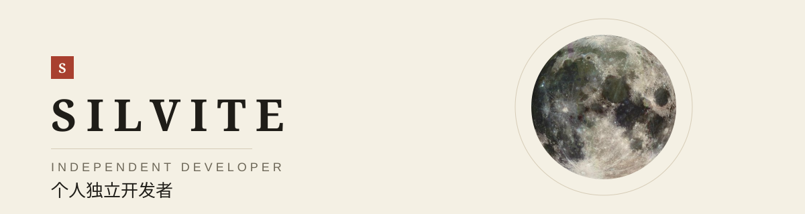
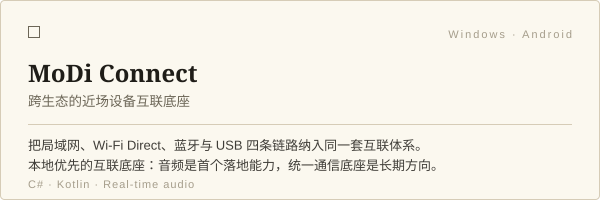
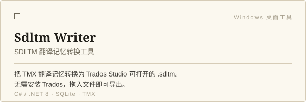
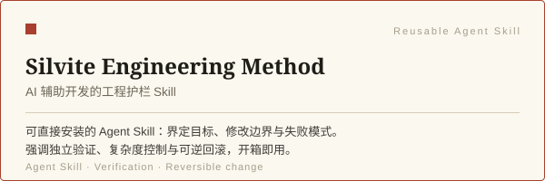
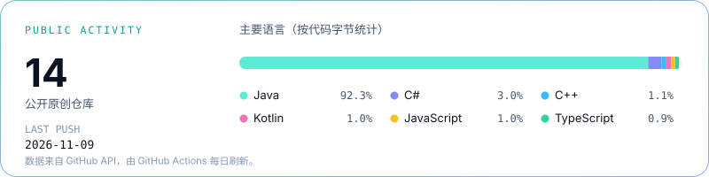

<div align="center">

<picture>
  <source media="(prefers-color-scheme: dark)" srcset="assets/banner-dark.svg">
  
</picture>

</div>

<br>

## 关于我

我是 **Silvite**，一名 **个人独立开发者**（Independent Developer）。

我做的是能被真实使用的小工具与产品：跨设备互联、AI 辅助的翻译工作流，以及让 AI 辅助编码更可控的工程护栏。每个项目通常从一个具体的使用摩擦出发，先把核心闭环做通，再逐步打磨。

- **方向**：跨平台桌面与移动端、本地优先的工具、AI 辅助工作流
- **习惯**：边界清晰的架构、可验证的交付、可逆的改动
- **常用技术**：C# / .NET · Kotlin / Android · TypeScript / React · Python · PowerShell

<br>

## 精选作品

<table>
  <tr>
    <td width="50%">
      <a href="https://github.com/LaoYinBai/MoDi-Connect">
        <picture>
          <source media="(prefers-color-scheme: dark)" srcset="assets/card-modi-connect-dark.svg">
          
        </picture>
      </a>
    </td>
    <td width="50%">
      <a href="https://github.com/LaoYinBai/Silvite-Translate-Lab">
        <picture>
          <source media="(prefers-color-scheme: dark)" srcset="assets/card-translate-lab-dark.svg">
          
        </picture>
      </a>
    </td>
  </tr>
  <tr>
    <td width="50%">
      <a href="https://github.com/LaoYinBai/Sdltm-Writer">
        <picture>
          <source media="(prefers-color-scheme: dark)" srcset="assets/card-sdltm-writer-dark.svg">
          
        </picture>
      </a>
    </td>
    <td width="50%">
      <a href="https://github.com/LaoYinBai/Silvite-Engineering-Method">
        <picture>
          <source media="(prefers-color-scheme: dark)" srcset="assets/card-engineering-method-dark.svg">
          
        </picture>
      </a>
    </td>
  </tr>
</table>

### 作为可复用 Skill 使用：Silvite Engineering Method

[Silvite Engineering Method](https://github.com/LaoYinBai/Silvite-Engineering-Method) 是一组可直接安装到 Agent Skills 目录的工程 Skill，用于约束 AI 编码助手：先界定目标与修改边界，再受控执行，最后用独立证据验证并保留回滚路径。

```bash
git clone https://github.com/LaoYinBai/Silvite-Engineering-Method.git
```

将 `silvite-engineering-method/` 复制到宿主的 Skills 目录（例如 `~/.agents/skills`）即可使用；大型架构迁移与分层环境工程可额外安装对应的互补 Skill。

<br>

## 开发活动

<table>
  <tr>
    <td width="36%" valign="top">
      <picture>
        <source media="(prefers-color-scheme: dark)" srcset="assets/stats-dark.svg">
        
      </picture>
    </td>
  </tr>
  <tr>
    <td valign="top">
      <picture>
        <source media="(prefers-color-scheme: dark)" srcset="assets/pacman/pacman-contribution-graph-dark.svg">
        
      </picture>
    </td>
  </tr>
</table>

<br>

## 联系

<a href="mailto:silvite@modiconnect.cn">
  
</a>

<br><br>

GitHub · [github.com/LaoYinBai](https://github.com/LaoYinBai)

<br>

<sub>
  统计与热力图由 GitHub Actions 每日自动刷新。热力图由
  <a href="https://github.com/abozanona/pacman-contribution-graph">pacman-contribution-graph</a>
  生成。
</sub>
