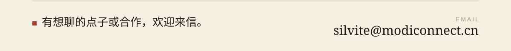

  <picture>
    <source media="(prefers-color-scheme: dark)" srcset="assets/banner-dark.svg">
    
  </picture>

  喜欢动手做实用又有点意思的东西，大大小小的项目都做。 
  Building practical and fun things, big and small.

<table>
  <tr>
    <td width="50%">
      <a href="https://github.com/LaoYinBai/MoDi-Connect">
        <picture>
          <source media="(prefers-color-scheme: dark)" srcset="assets/card-modi-connect-dark.svg">
          
        </picture>
      </a>
    </td>
    <td width="50%">
      <a href="https://github.com/LaoYinBai/Silvite-Translate-Lab">
        <picture>
          <source media="(prefers-color-scheme: dark)" srcset="assets/card-translate-lab-dark.svg">
          
        </picture>
      </a>
    </td>
  </tr>
  <tr>
    <td width="50%">
      <a href="https://github.com/LaoYinBai/Sdltm-Writer">
        <picture>
          <source media="(prefers-color-scheme: dark)" srcset="assets/card-sdltm-writer-dark.svg">
          
        </picture>
      </a>
    </td>
    <td width="50%">
      <a href="https://github.com/LaoYinBai/Silvite-Engineering-Method">
        <picture>
          <source media="(prefers-color-scheme: dark)" srcset="assets/card-engineering-method-dark.svg">
          
        </picture>
      </a>
    </td>
  </tr>
</table>

  <picture>
    <source media="(prefers-color-scheme: dark)" srcset="assets/pacman/pacman-contribution-graph-dark.svg">
    
  </picture>

  <a href="mailto:silvite@modiconnect.cn">
    <picture>
      <source media="(prefers-color-scheme: dark)" srcset="assets/footer-dark.svg">
      
    </picture>
  </a>

  GitHub · <a href="https://github.com/LaoYinBai">github.com/LaoYinBai</a>

